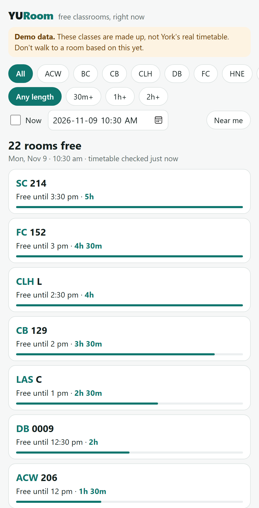
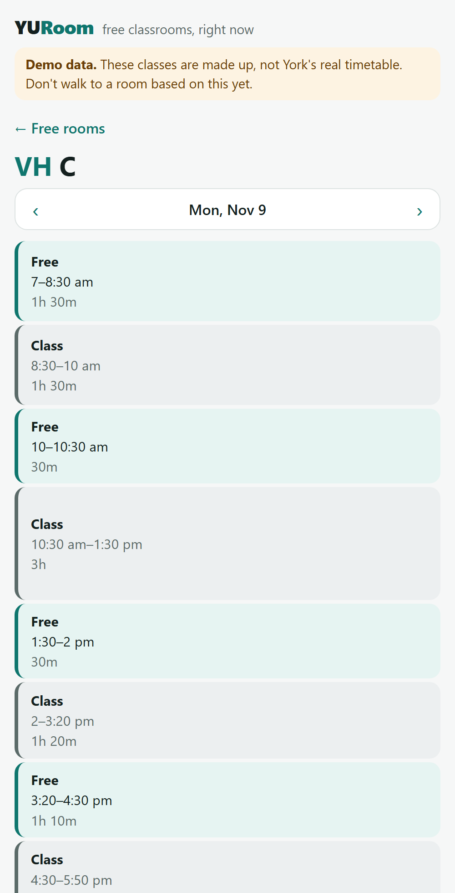
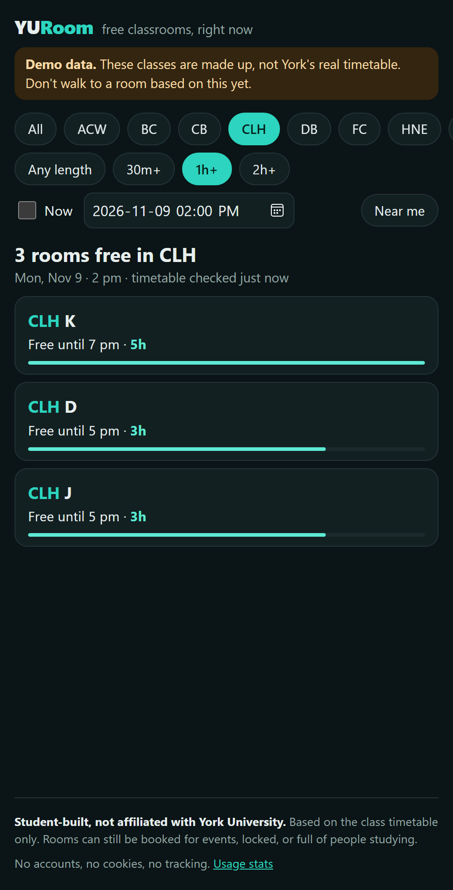
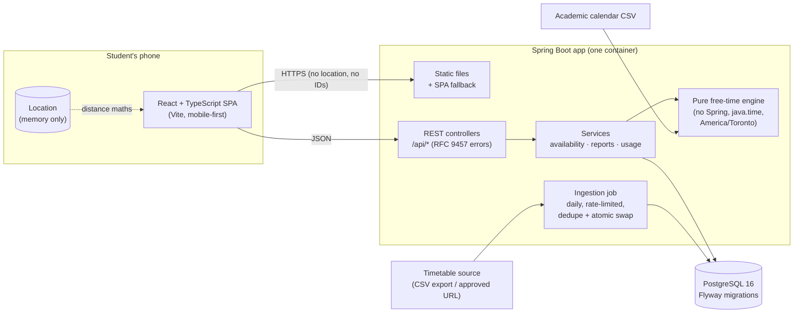

# YURoom

**Find an empty classroom at York University to study in, right now.**
YURoom shows which classrooms have no class scheduled at this moment and how long each stays free:
"Free until 2:30 pm · 1h 45m". It is mobile-first, has no login, and keeps your location on your phone.

[](https://github.com/haydenho08/yuroom/actions/workflows/ci.yml)

> **Student-built, not affiliated with York University.** YURoom uses the class timetable only;
> rooms can still be booked for events, locked, or full of people studying.
> **Data status:** the public demo runs on a *synthetic* timetable (made-up classes, clearly labelled
> in the app) while I ask the Registrar's Office for permission to use the real one. See
> [docs/stage-0.md](docs/stage-0.md) for why I didn't scrape it.

<p>
  
  
  
</p>

## Features
- **Free rooms now (or at any time you pick)**, longest-free first, filterable by building and
  "free for at least 30 min / 1 h / 2 h".
- **Room timeline** for any day: free and booked blocks, with "now" highlighted.
- **Knows the academic calendar:** reading weeks, holidays, exam periods (when the class timetable
  doesn't apply, and the app says so instead of claiming every room is free), and term boundaries.
- **Near me:** sorts by walking distance. The location is used only in the browser and is never sent to the server.
- **"Actually occupied" reports:** anonymous, rate-limited, and expire after an hour. They are shown as a warning, never by hiding a room.
- **Public [usage stats](#privacy)**, from analytics that store no personal data.

## Architecture



| Layer | Choice | Why |
|---|---|---|
| API | Java 21, Spring Boot 3.5, Spring Data JPA | Layered controller → service → repository, DTOs separate from entities, validation, consistent [problem+json](https://www.rfc-editor.org/rfc/rfc9457) errors |
| Core logic | Plain Java (`availability/core`) | Interval merging, DST-safe minutes, calendar rules. Unit-tested without Spring |
| Data | PostgreSQL 16, Flyway | Schema in versioned SQL; covering indexes measured with `EXPLAIN ANALYZE` (2.7 ms vs 12 ms) |
| Frontend | React 19, TypeScript, Vite | URL-as-state filters, polling plus refresh on tab focus, about 90 KB gzipped |
| Tests | JUnit 5, Testcontainers, Vitest | 185 backend tests against a real Postgres; 72 frontend tests. Both suites run in the Auckland time zone on purpose, to catch zone bugs |
| Delivery | Docker (multi-stage, layered, non-root), GitHub Actions | One image serves UI + API from one origin; CI runs build, tests, lint, types and the image build |

## Engineering highlights
Each stage has a write-up of the decisions, the tradeoffs and the interview questions it answers:

- **[Stage 0, data source ethics](docs/stage-0.md):** the official site is behind a bot challenge and
  its terms forbid redistribution, so there's no scraping: there's a pluggable `TimetableSource` and a request to the Registrar.
- **[Stage 1, ingestion](docs/stage-1.md):** robots.txt (RFC 9309), per-host rate limiting, conditional
  GET, SHA-256 dedupe, raw snapshots, a reject-ratio guard and an atomic per-term swap. It also fixed a
  4–5-hour time-zone shift bug caused by a Hibernate setting.
- **[Stage 2, the "is it free?" engine](docs/stage-2.md):** half-open intervals, merging, the academic
  calendar's precedence rules, compute-on-request vs precompute, and justified indexes.
- **[Stage 3, frontend](docs/stage-3.md):** campus time is shown without browser conversion, and stale answers are aborted.
- **[Stage 4, near me and crowd reports](docs/stage-4.md):** client-side haversine; rate limiting
  people without identifying them, using an HMAC with a rotating in-memory secret.
- **[Stage 5, production](docs/stage-5.md):** CI, the container, trusted-proxy handling, a CSP,
  privacy-friendly analytics and the [deploy guide](docs/deploy.md).

## Run it locally
Prerequisites: Docker Desktop, JDK 21, Node 22.

```bash
docker compose up -d --wait          # Postgres 16 on localhost:5433
```

```bash
cd backend && ./gradlew bootRun      # API on :8080, loads data/sample/timetable-sample.csv
```

```bash
cd frontend && npm install && npm run dev   # UI on :5173, proxies /api to :8080
```

On Windows use `gradlew.bat`. To run the production image (UI and API in one container, with the
larger demo timetable) against the same database:

```bash
docker compose --profile full up --build
```

### Tests and checks
```bash
cd backend && ./gradlew build        # compile with -Xlint:all + all tests (needs Docker for Testcontainers)
```

```bash
cd frontend && npm run lint && npm run typecheck && npm test
```

## Privacy
- **No accounts, no cookies, no tracking IDs.**
- **Location never leaves the device.** Distances are computed in the browser; a test asserts that no
  request URL, body or header contains coordinates.
- **Reports store no reporter data.** The table is `(id, room_id, created_at, expires_at)`. Rate limiting
  uses an HMAC of the IP with a secret that lives only in memory and rotates daily.
- **Analytics are daily counters only.** The whole schema is `(day, event, count)`. The browser remembers the
  date of its own last visit to decide whether it's a "new visitor this week", and never sends that date.
  The numbers are public at `/stats`. Browsers with Global Privacy Control or Do Not Track enabled aren't counted.

## Project docs
[CSV format](docs/timetable-csv-format.md) · [Registrar request](docs/registrar-request.md) ·
[Deploy guide](docs/deploy.md) · [Launch plan](docs/launch-plan.md)

---
Built by Hayden Ho (York University, Software Engineering). Building codes and coordinates are from
© OpenStreetMap contributors (ODbL). York University's name is used only to describe what the app is
for; YURoom uses no York logos or branding.
