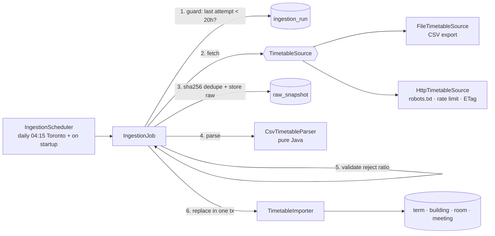

# Stage 1 — Data model + ingestion

**Goal:** get timetable data into Postgres reliably, politely and auditably, without depending
on any one data source.

## Architecture



## Data model

| Table | What it is | Key decisions |
|---|---|---|
| `term` | e.g. `2026FA` | Dates = span of its meetings. Stage 2 adds breaks, holidays and exams. |
| `building` | acronym, campus | Natural key `code` is unique. |
| `room` | building + number | `unique (building_id, number)`. Rooms are never deleted, just left without meetings. |
| `meeting` | weekly recurring booking | `day_of_week` stored as ISO 1–7; `LocalTime` start/end (wall-clock, not instants); start/end dates; CHECK constraints. |
| `raw_snapshot` | exact bytes collected | `unique (source, sha256)`: the same bytes are stored once. |
| `ingestion_run` | audit log | Status, counts and message for every attempt. |

## How a run works
1. **Guard.** If any attempt for this source started less than `min-interval` (20h) ago, skip.
   This is read from the DB, so restarts and crash loops can't cause extra fetches.
2. **Fetch, outside any transaction.** Never hold a DB connection while waiting on the network.
3. **Dedupe by SHA-256.** Identical bytes mean `UNCHANGED`: no parse, no writes. HTTP sources also
   send `If-None-Match`/`If-Modified-Since` and accept a 304.
4. **Store raw first**, in its own commit, so we keep the evidence even if parsing fails.
5. **Parse** with a pure parser that rejects bad rows individually, with line numbers.
6. **Validate the file as a whole.** If nothing parsed, or more than 20% of rows were rejected,
   mark it `FAILED` and keep serving yesterday's timetable.
7. **Replace atomically.** Delete the term's meetings and insert the new ones in one transaction.

## Politeness (HttpTimetableSource)
Disabled by default. Use it only for a URL York approves.
- **robots.txt first**, cached 24h, evaluated per RFC 9309 (groups, longest match, `*` and `$`).
- **Unreadable robots.txt means "no".** 404/410 means "no rules" (allowed); 401/403, 429, 5xx and
  network errors mean disallow. A Cloudflare challenge is a 403, so we stop. A unit test simulates
  exactly what York's site does.
- **Generic User-Agent** `YURoom student project`. No personal email.
- **Per-host rate limit** (10s) on every request, robots.txt included.
- **Backs off** on 429/503 instead of retrying. **No redirects** to hosts we haven't checked.
- **At most daily** (cron + DB guard).

## Tradeoffs worth talking about
- **Raw bytes in Postgres vs. on disk / S3.** One system, transactional and simple to back up.
  The cost is DB size: a nightly change is maybe a few MB, so we'd add retention (keep N) later.
- **Full replace vs. incremental diff.** Replacing a term is simple and obviously correct, and the
  data is small (~tens of thousands of rows). Diffing would save writes but adds complexity and bugs.
- **Sequence ids for `meeting`.** `IDENTITY` makes Hibernate insert one row per round trip. A sequence
  with `allocationSize = 50` plus `hibernate.jdbc.batch_size` lets it batch the bulk insert.
- **Partial-failure policy.** Some bad rows are fine (keep the good ones, log the bad). Too many bad
  rows probably means the format changed, and serving half a timetable is worse than serving yesterday's.
- **Single instance.** The in-memory "already running" flag only works for one app instance.
  With several, use a Postgres advisory lock or ShedLock.

## Bugs the end-to-end run caught (and the tests now guard)
1. **Time-zone shift.** `hibernate.jdbc.time_zone: UTC` made Hibernate convert our wall-clock
   `LocalTime`s through the JVM's zone: "08:30" was stored as "13:30", and evening classes
   "crossed midnight" and broke the CHECK constraint. The fix is `hibernate.type.java_time_use_direct_jdbc: true`
   (no conversion at all). Tests now run with `user.timezone=Pacific/Auckland`, and a regression test
   asserts the exact stored times. I confirmed it fails with the old setting.
   *Lesson:* unit tests passed because they never looked at what landed in the database, and they
   ran in the same zone as the app. Constraints in the DB turned silent corruption into a loud failure.
2. **Relative path binding.** Spring converts a `String` to a `Path` as a resource location and rejects
   `../data/...`. The config binds a `String` and calls `Path.of` explicitly. There's a regression test.

## Testing
- `CsvTimetableParserTest`: fixtures in `src/test/resources/fixtures` (synthetic, never the live
  site). Covers day codes, duration vs end time, quoting, BOM, legacy charset, and per-row errors
  with line numbers.
- `RobotsTxtTest`, `HostRateLimiterTest`: pure unit tests. The rate limiter uses a fake clock, so no sleeping.
- `HttpTimetableSourceTest`: a real local HTTP server (JDK `HttpServer`) for robots.txt handling,
  User-Agent, conditional GET, 429 and redirects.
- `IngestionJobIntegrationTest`: Testcontainers Postgres 16. Covers Flyway, Hibernate schema validation,
  dedupe, the daily guard, replacement, and that a bad file keeps the old data.

## Run it yourself (PowerShell, from the repo root)
```powershell
docker compose up -d --wait            # Postgres 16 on localhost:5433
cd backend
.\gradlew.bat test                     # 51 tests; needs Docker running for Testcontainers
.\gradlew.bat bootRun                  # ingests data/sample/timetable-sample.csv on first start
docker exec yuroom-db psql -U yuroom -d yuroom -c "select status, message from ingestion_run"
```

## Concepts & interview questions
| Concept | Question it answers |
|---|---|
| Adapter / strategy (`TimetableSource`) | "How would you add a new data source?" |
| Idempotency via content hash | "What happens if the job runs twice?" |
| Transaction boundaries | "Why isn't the whole job one `@Transactional`?" |
| Atomic replace | "What do users see while an import is running?" |
| Defensive ingestion (reject ratio) | "What if the upstream format changes overnight?" |
| HTTP caching (ETag / 304) | "How do you avoid re-downloading unchanged data?" |
| robots.txt / RFC 9309 | "How do you crawl responsibly?" |
| Flyway + `ddl-auto=validate` | "Who owns your schema, and how do you evolve it?" |
| Testcontainers vs H2 | "Why test against real Postgres?" |
| Injected `Clock` | "How do you unit-test time-dependent code?" |
| `LocalTime` vs `Instant`, JDBC zone handling | "Tell me about a bug you found and how you prevented it coming back." |
