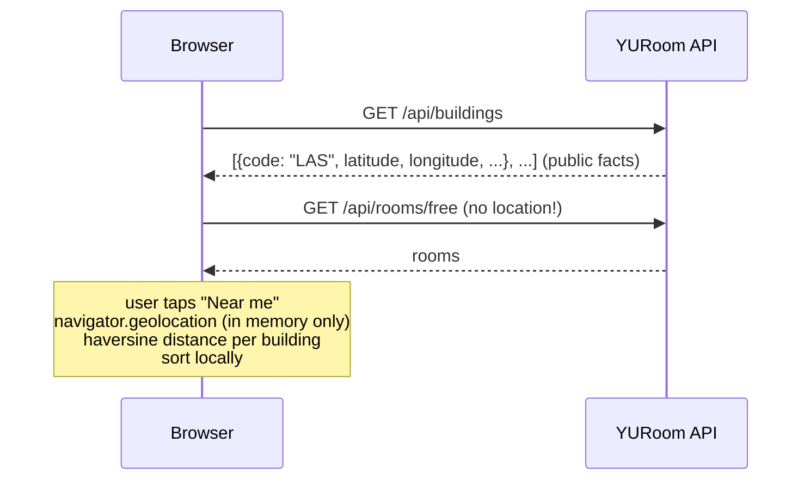

# Stage 4 — "Near me" + crowd reports

**Goal:** sort rooms by how close they are without the server ever learning where anyone is, and
let students flag "this room is actually occupied" anonymously, in a way that's hard to abuse.

## Part A — Near me (location never leaves the browser)

- **Building coordinates** are hand-curated in `backend/src/main/resources/buildings/buildings.csv`
  (29 teaching buildings). Names and centroids come from **OpenStreetMap** (© OpenStreetMap contributors,
  ODbL, with attribution in the file), queried once via Overpass. Codes are the timetable acronyms.
  A test checks that every Keele building is within about 1.5 km of Vari Hall, to catch typos.
- **The server sends coordinates to everyone; the browser does the maths.** Haversine
  great-circle distance gives a "10 m · 1 min walk" estimate (+30% for paths, 80 m/min).
- **Privacy by design, enforced by tests:**
  - Location is requested only when the user taps **Near me**, never on page load.
  - It lives in React state only: not in the URL (so it can't leak into a shared link), not in
    localStorage, never in a request. A test turns on Near me, triggers more requests, and asserts
    that no URL, body or header contains the coordinates.
  - Turning it off calls `clearWatch` and forgets the position.
  - `enableHighAccuracy: false`: building-level precision is enough and saves battery.
- **Ranking:** unreported rooms first, then nearest building, then longest-free (a stable sort keeps the
  server's order). Buildings without coordinates go last. If the nearest building is more than 3 km
  away, we say "You seem to be off campus" instead of sorting nonsense.

**Why not compute distance on the server?** It would need the user's location, which is personal data.
Storing it, logging it or leaking it becomes our problem, with privacy-law obligations (e.g. PIPEDA in
Canada). Doing the maths on the client avoids all of that, and the data needed (~30 coordinates) is tiny.

## Part B — Crowd reports

`POST /api/rooms/{id}/reports` (no body) → `201 {roomId, expiresAt, activeReports, lastReportedAt}`.

| Rule | How |
|---|---|
| Anonymous | The table is `(id, room_id, created_at, expires_at)`, nothing else. A test asserts the exact column list. |
| Expires after ~60 min | `expires_at = created_at + 60m`. Queries filter on it, so expiry needs no job. A cleanup job every 15 min deletes old rows to keep the table small. |
| Applies to its moment | Active at time *t* means `created_at <= t < expires_at`, so a report now doesn't affect "tomorrow at 2pm". |
| Shown as a warning | Reported rooms stay in the list (a warning, not a verdict) but move after unreported ones. The room page shows the warning. |
| Rate-limited | 1 report per room per client per 30 min; 10 per client per hour. Exceeding either gives **429** + `Retry-After` + problem+json. |

### How do you rate-limit people you refuse to identify?
- The key is **HMAC-SHA256(secret, client IP)**. The secret is 32 random bytes that exist only in memory
  and are **replaced every 24 hours** and on every restart.
- Why not just `sha256(ip)`? There are only about 4 billion IPv4 addresses, so a plain hash is reversed by
  brute force in minutes. With a secret that's never stored, nobody (including us) can link a key back
  to an address, or yesterday's key to today's.
- Keys and timestamps live in an in-memory **sliding-window log** (`RateLimiter`, pure Java, injected
  clock). Memory is bounded: idle keys are pruned, and above 100k keys the least-recently-used one is evicted.
  Eviction can only make us more lenient, never block someone wrongly.

### Abuse model and its limits (be honest in interviews)
- One person on one connection can't flood: 429s.
- Someone on many IPs (VPN hopping) could flag rooms. The damage is bounded: rooms are **never hidden**,
  only warned about and moved down, and every report disappears in an hour.
- Many students share one campus NAT IP, so the per-client limit is generous (10/hour). That's a
  tradeoff between abuse resistance and false positives.
- **Single instance only.** In-memory limits don't work across several servers. The next step would be
  Redis (`INCR` with expiry, or a sorted set per key), the same tool I used in Statblox.
- **Behind a reverse proxy** every request looks like it comes from the proxy. Stage 5 must configure
  trusted `X-Forwarded-For` handling (`server.forward-headers-strategy`) for the host's proxy only.
  Trusting the header from anyone would let clients pick their own rate-limit key.

### UI
- The room page has "Room actually occupied?" → "Yes, it's occupied". **Two taps**, so a stray tap on a phone
  doesn't file a report. It's only offered when viewing today (reports describe now) and when the timetable applies.
- Lists show "⚠ Reported occupied by 2 people 12 min ago".

## Verified end to end
- With Near me on (geolocation stubbed to Vari Hall): VH rooms "10 m · 1 min walk" first, then Ross, then ACW.
- Reported VH B in the browser → warning shown; the API moved it from #2 to #21 of 21; a second
  report from the same client got `429 Retry-After: 1792`; the database row is `(id, room_id, created_at, expires_at)`.

## Tests
- Backend: 160 (+22). `RateLimiterTest` (window sliding, retry-after, LRU bound), `ClientKeysTest`
  (rotation, unlinkability), `BuildingDirectoryTest` (real file, sanity bounds), `ReportApiIntegrationTest`
  (mutable clock: expiry, ranking, moment-scoping, both limits, 404, schema has no reporter columns).
- Frontend: 58 (+24). Haversine against known campus distances, ranking, the no-location-leak test,
  permission denied, off campus, two-tap report, 429 message.

## Concepts & interview questions
| Concept | Question it answers |
|---|---|
| Client-side computation for privacy | "Why doesn't your server know where users are?" |
| Data minimization, privacy by design | "What personal data do you store?" (none) |
| HMAC with a rotating secret vs plain hashing | "How do you rate-limit without tracking people?" |
| Sliding-window log vs token bucket vs fixed window | "Design a rate limiter." |
| TTL-based data / soft expiry vs cleanup job | "How do you expire data?" |
| Abuse modelling, bounded damage | "How could someone abuse this feature?" |
| Single-instance state, when to use Redis | "What breaks when you scale to two servers?" |
| Haversine / great-circle distance | "How do you compute distance between coordinates?" |
| Open data licensing (ODbL attribution) | "Where did your map data come from?" |
